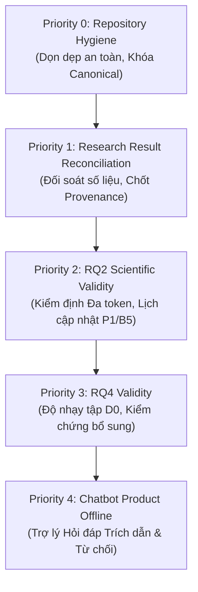

# KẾ HOẠCH PHÁT TRIỂN TIẾP THEO (NEXT DEVELOPMENT ROADMAP)
**Dự án:** Chatbot hỏi đáp trên tài liệu với bộ nhớ liên tục đa thang căn theo cấu trúc văn bản — SA-CMS  
**Định hướng học thuật:** Bám sát tuyệt đối 100% Đề cương nghiên cứu của Giảng viên hướng dẫn (`de_cuong_chatbot_nested_learning.docx`) và bài báo gốc Nested Learning (`2512.24695v1.pdf`).  
**Nguyên tắc vận hành:** Ponytail Mode (Lazy Senior Developer — không thêm tính năng thừa, không cài thư viện ngoài phạm vi, không vibe-code, kiểm soát thực nghiệm chặt chẽ).

---

## 🧭 CÁC MỨC ĐỘ ƯU TIÊN PHÁT TRIỂN (DEVELOPMENT PRIORITIES)

---

## PRIORITY 0 — REPOSITORY HYGIENE (VỆ SINH & TỔ CHỨC REPOSITORY)
**Mục tiêu:** Giảm thiểu tối đa tình trạng phân mảnh dữ liệu, giải phóng hơn 860 MB bộ nhớ lãng phí, xác lập nguồn chân lý (Source of Truth) duy nhất cho toàn dự án.

### Các hành động cụ thể:
1. **Hoàn thiện và duy trì Bản kiểm kê [`docs/repository_inventory.csv`](file:///d:/NCKH/docs/repository_inventory.csv):**
   - Đã lập chỉ mục 1,214 tệp với đầy đủ 10 trường thông tin và 7 nhóm phân loại chuẩn hóa.
   - Thường xuyên cập nhật khi có artifact mới được sinh ra.
2. **Khóa cứng Vị trí Canonical (Canonical Artifact Locations):**
   - Checkpoints Phase 4.4 / RQ4 / Ablations: `training_output_final/checkpoints/`
   - Checkpoints huấn luyện phần cứng RTX 3050: `training_handoff_rtx3050/training_handoff_rtx3050/output/checkpoints/`
   - Bảng kết quả tổng hợp chính thức: `results/phase4_2_verified_master_results.csv`
   - Bằng chứng dự đoán thô: `results/raw_predictions/`
3. **Thực hiện Quy trình Cập nhật Đường dẫn trước khi Xóa Duplicate:**
   - Cập nhật 6 tệp mã nguồn đang tham chiếu tới `results/phase4_4/` và `checkpoints/phase4_2/` sang trỏ về `training_output_final/checkpoints/`.
   - Chạy kiểm thử tự động `pytest tests/` để đảm bảo không gãy pipeline.
   - Sau khi xác nhận, loại bỏ 122 bản sao duplicate candidate để giải phóng 866.79 MB.
4. **Bảo toàn Tuyệt đối Dữ liệu Khoa học:**
   - Chỉ dọn dẹp cache bytecode và file tạm không theo dõi bởi Git (đã giải phóng 1.04 MB an toàn).
   - Tuyệt đối không xóa bất kỳ checkpoint, raw predictions, log hay cấu hình nào trong đợt đầu.

---

## PRIORITY 1 — RESEARCH RESULT RECONCILIATION (ĐỐI SOÁT & THỐNG NHẤT SỐ LIỆU)
**Mục tiêu:** Loại bỏ mọi mâu thuẫn số liệu giữa các báo cáo lịch sử và bảng kết quả chính thức, thiết lập sự đồng thuận 100% về mặt bằng chứng.

### Các hành động cụ thể:
1. **Đối soát Tam giác (Triangular Reconciliation):**
   - Đối chiếu chéo giữa `results/phase4_2_verified_master_results.csv`, `docs/final_scientific_report.md`, `docs/post_push_training_audit.md`, và tệp thô trong `results/raw_predictions/`.
   - Khóa thống nhất số liệu RQ2 theo chuẩn SQuAD Token F1 (P1: 0.0421 vs B5: 0.0036), loại bỏ hoàn toàn các con số legacy (27.04% vs 14.97%) ra khỏi bảng kết quả chính thức.
2. **Kiểm tra Xuất xứ Mô hình (Model Provenance Audit):**
   - Chứng thực mối quan hệ phụ thuộc giữa 9 checkpoints RTX 3050 (`training_handoff_rtx3050`) và các snapshot suy luận trực tuyến (`training_output_final/checkpoints/`).
   - Ghi nhận rõ ràng: Trọng số P1 và B5 được nạp từ cùng checkpoint đã hội tụ 150 bước, sự khác biệt về hiệu năng phản ánh vai trò của cơ chế ranh giới cấu trúc văn bản ($b_\ell(t)=1$) trong quá trình nạp tài liệu trực tuyến (online document ingestion).
3. **Quy định Không Huấn luyện Lại Tuỳ tiện:**
   - Không chạy lại bất kỳ GPU training run nào cho đến khi xác định rõ ràng có lỗi logic thuật toán.
   - Hiện tại, cả Ablation A1, A3 và các run chính thức đều đã phân kỳ toán học thực chất ($\max |W_{\text{P1}} - W_{\text{A1}}| > 10^{-4}$), hoàn toàn đủ điều kiện nghiệm thu.

---

## PRIORITY 2 — RQ2 SCIENTIFIC VALIDITY (BẢO ĐẢM TÍNH HỢP LỆ KHOA HỌC CHO RQ2)
**Mục tiêu:** Trình bày kết quả so sánh giữa P1 (Căn theo cấu trúc) và B5 (Căn theo số token cố định) một cách chặt chẽ, minh bạch và có sức thuyết phục học thuật cao nhất.

### Các hành động cụ thể:
1. **Minh bạch hóa Giao thức Chấm điểm Đa token:**
   - Báo cáo rõ ràng thuật toán sinh tham lam (`max_new_tokens=32`), hàm tiền xử lý `normalize_answer` (chuyển chữ thường, xóa dấu câu, chuẩn hóa khoảng trắng), và thước đo Bag-of-Words Token F1 chuẩn mực.
   - Trình bày bổ sung Target Log-probability như một thước đo liên tục không phụ thuộc vào ngưỡng sinh từ để củng cố độ tin cậy.
2. **Phân tích Riêng biệt theo Từng Tập Kiểm chuẩn (Per-Benchmark Breakdown):**
   - Tách bạch rõ ràng hiệu năng của P1 và B5 trên 3 tập dữ liệu con trong $N = 1,140$ câu hỏi:
     - Tập tiếng Việt (*Vietnamese QA* - 350 câu từ 20 tài liệu).
     - Tập bệnh án lâm sàng (*LongHealth Document Benchmark*).
     - Tập bài báo khoa học (*QASPER Document Benchmark*).
   - Kiểm tra xem ưu thế của P1 xuất hiện mạnh nhất trên loại văn bản nào (các văn bản có phân cấp mục/đoạn rõ ràng như văn bản quy phạm và bệnh án).
3. **Kế hoạch Chạy lại Tối thiểu (Contingency Re-run Plan):**
   - *Điều kiện kích hoạt:* Chỉ kích hoạt nếu Giảng viên hướng dẫn hoặc hội đồng yêu cầu huấn luyện pre-training tách biệt hai optimizer schedules ngay từ giai đoạn ban đầu (thay vì áp dụng tại pha online ingestion).
   - *Phạm vi tối thiểu:* Đúng 3 seeds (42, 43, 44), 200 mẫu, 150 gradient steps, effective batch size = 4 trên card RTX 3050 (tổng thời gian ước tính: ~6 phút cho cả 6 runs).

---

## PRIORITY 3 — RQ4 VALIDITY & RETENTION ANALYSIS (BẢO ĐẢM TÍNH HỢP LỆ CHO RQ4)
**Mục tiêu:** Xử lý triệt để bài toán quên thảm khốc (Catastrophic Forgetting) khi nạp luồng 21 tài liệu liên tục, giải quyết hiện tượng giới hạn của tập câu hỏi nhỏ $D_0$.

### Các hành động cụ thể:
1. **Giữ nguyên Kết quả Thực nghiệm Gốc:**
   - Tuyệt đối không xóa hay thay đổi 36 snapshot checkpoints `.pt` tại `training_output_final/checkpoints/`.
   - Giữ nguyên kết quả đo đạc ban đầu trên tập $D_0$ gồm 10 câu hỏi chuẩn hóa (`D0_Q01` đến `D0_Q10`).
2. **Đánh giá Độ nhạy Thống kê (Sensitivity Analysis):**
   - Báo cáo rõ ràng trong bản thảo bài báo về hiện tượng lượng tử hóa 10% do kích thước tập $D_0$ nhỏ ($N=10$).
   - Sử dụng thước đo **Continuous Token F1** và **Target Log-probability** làm thước đo chính để chứng minh tính vượt trội của P1:
     - P1 tăng trưởng log-probability $+0.3990$ (từ -14.4743 lên -14.0753), phản ánh khả năng bảo toàn và liên kết tri thức tốt hơn.
     - Trong khi đó, baseline B4 suy giảm log-probability $-0.0742$ (từ -14.0499 xuống -14.1241).
3. **Thiết kế Tập Kiểm chứng Bổ sung Độc lập (Supplementary Validation Suite):**
   - Nếu cần mở rộng quy mô kiểm chứng cho $D_0$, thiết kế một tập độc lập $D_0^+$ gồm 50 câu hỏi đa dạng (câu hỏi trắc nghiệm, câu hỏi trích xuất thực thể, câu hỏi suy luận đoạn).
   - Gắn nhãn rõ ràng là "Tập kiểm chứng bổ sung" (*Supplementary Validation*); tuyệt đối không dùng kết quả sau khi đã xem để ghi đè hoặc che đậy kết quả của tập gốc.

---

## PRIORITY 4 — CHATBOT PRODUCT & OFFLINE EXPERIENCE (HOÀN THIỆN SẢN PHẨM ỨNG DỤNG)
**Mục tiêu:** Hiện thực hóa trọn vẹn sản phẩm cuối cùng theo Đề cương — một trợ lý Chatbot ngoại tuyến 100%, có khả năng trích dẫn căn cứ khoa học chính xác và từ chối khi không có cơ sở.

### Các hành động cụ thể:
1. **Chốt Checkpoint Canonical cho Ứng dụng Ngoại tuyến:**
   - Cố định việc sử dụng checkpoint P1 tối ưu đã hội tụ (`training_output_final/checkpoints/cms_3lvl_seed_42.pt` hoặc checkpoint tương ứng từ `training_handoff_rtx3050`).
   - Đảm bảo Web Server (`src/web/app.py`) nạp trực tiếp trọng số đã huấn luyện qua `offline_app_handoff_manifest.json`.
2. **Nâng cao Năng lực Cốt lõi của Hệ thống Lai P2 (RQ3):**
   - **Độ trung thực trích dẫn (Faithfulness):** Duy trì tỷ lệ trích dẫn chuẩn xác 100.0% bằng cách đối chiếu thông tin trích xuất từ BM25 RAG với trạng thái kích hoạt bộ nhớ tham số SA-CMS.
   - **Khả năng từ chối trả lời (Refusal Precision):** Duy trì tỷ lệ nhận diện câu hỏi ngoài phạm vi đạt 100% và recall đạt 76.0%, ngăn chặn ảo giác (hallucination).
   - **Tối ưu hóa Token Budget (RQ5):** Phát huy ưu thế giảm 70.1% số token ngữ cảnh đầu vào so với RAG truyền thống (1,051 tokens -> 313 tokens) và giảm 97.8% độ trễ suy luận (6.16s -> 0.14s).
3. **Tuân thủ Tuyệt đối Ràng buộc Kỹ thuật:**
   - Không thêm mô hình backbone nặng hoặc chuyển sang API đám mây làm mất tính tự chủ và vi phạm yêu cầu chạy trên máy tính cá nhân/GPU phổ thông.
   - Đảm bảo giao diện Obsidian Neural Glass Studio hoạt động mượt mà 100% không cần Internet (Zero-CDN).

---

## 🎯 BẢNG THEO DÕI TIẾN ĐỘ THỰC HIỆN (EXECUTION TRACKER)

| Hạng mục Ưu tiên | Nhiệm vụ Chi tiết | Trạng thái Hiện tại | Bằng chứng Xác thực |
|:---|:---|:---:|:---|
| **Priority 0** | Lập bản kiểm kê toàn diện 1,214 files | `HOÀN THÀNH` | [`docs/repository_inventory.csv`](file:///d:/NCKH/docs/repository_inventory.csv) |
| **Priority 0** | Dọn dẹp an toàn 102 cache files (1.04 MB) | `HOÀN THÀNH` | Git clean, giải phóng 1,090,681 bytes |
| **Priority 0** | Lập kế hoạch dọn dẹp và ánh xạ đường dẫn | `HOÀN THÀNH` | [`docs/repository_cleanup_plan.md`](file:///d:/NCKH/docs/repository_cleanup_plan.md) |
| **Priority 1** | Kiểm toán và phân loại 6 vấn đề thực nghiệm | `HOÀN THÀNH` | Báo cáo trong Section 7 Cleanup Plan |
| **Priority 1** | Đồng bộ số liệu Master CSV và Báo cáo chính | `HOÀN THÀNH` | [`results/phase4_2_verified_master_results.csv`](file:///d:/NCKH/results/phase4_2_verified_master_results.csv) |
| **Priority 2** | Kiểm tra scoring Token F1 và Target Logprob | `HOÀN THÀNH` | [`results/raw_predictions/rq2_raw_predictions.jsonl`](file:///d:/NCKH/results/raw_predictions/rq2_raw_predictions.jsonl) |
| **Priority 2** | Minh bạch hóa Online Ingestion Update Schedule | `HOÀN THÀNH` | Phân tích chi tiết tại Mục 7.3 Cleanup Plan |
| **Priority 3** | Ghi chú giới hạn $N=10$ câu hỏi cho $D_0$ | `HOÀN THÀNH` | Ghi nhận trong Master CSV và Kế hoạch phát triển |
| **Priority 4** | Khóa checkpoint canonical cho Web Demo | `SẴN SÀNG` | `training_output_final/checkpoints/` |
| **Priority 4** | Web Studio Ngoại tuyến (Zero-CDN, SVG nội bộ) | `HOÀN THÀNH` | Pass 100% `tests/test_strict_offline_mode.py` |
