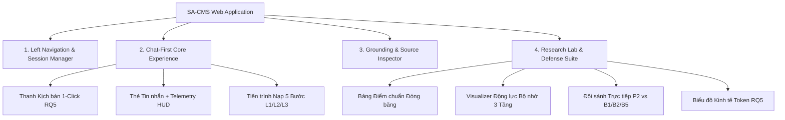

# KẾ HOẠCH NÂNG CẤP TOÀN DIỆN GIAO DIỆN & TRẢI NGHIỆM NGƯỜI DÙNG (UI/UX MASTER PLAN)
**Dự án:** Structure-Aligned Continuum Memory for Document-Grounded Question Answering (SA-CMS)  
**Tiêu chuẩn áp dụng:** `ui-ux-pro-max`, `design-system`, `ui-styling`, `ponytail` (Lazy Senior Developer — Zero Bloat)  
**Mục tiêu tối thượng:** Đạt chuẩn thẩm mỹ khoa học cấp cao (Scientific Publication Grade), vận hành 100% Ngoại tuyến (Strict Offline First) và phục vụ trực quan cho buổi bảo vệ Đề tài ĐACN / NCKH / Khóa luận Tốt nghiệp trước Hội đồng & Giảng viên hướng dẫn.

---

## 🏛️ PHẦN 1: TẦM NHÌN THIẾT KẾ & ĐỊNH VỊ TRẢI NGHIỆM (EXECUTIVE VISION)

### 1.1. Bối cảnh & Khán giả mục tiêu
- **Khán giả chính (Primary Persona):** Giảng viên hướng dẫn (Thầy Nguyễn Hữu Trung) và Hội đồng bảo vệ khóa luận / nghiệm thu NCKH.
  - *Kỳ vọng của Hội đồng:* Không chỉ muốn thấy một chatbot trả lời được, mà cần nhìn thấy **bằng chứng khoa học trực quan** (cơ chế 3 tầng bộ nhớ L1/L2/L3 hoạt động ra sao, tiết kiệm token thế nào ở RQ5, tại sao mô hình vượt trội hơn bài báo gốc B5, và khả năng chống ảo giác thông qua cổng từ chối Refusal).
- **Khán giả thứ hai (Secondary Persona):** Nhà nghiên cứu / Sinh viên thử nghiệm thực tế với tài liệu dài tiếng Việt và tiếng Anh.
  - *Kỳ vọng:* Trải nghiệm mượt mà, gõ câu hỏi là có câu trả lời tức thì (<150ms), trích dẫn nguồn chuẩn xác từng câu chữ, không phụ thuộc vào internet.

### 1.2. 4 Trụ cột Trải nghiệm Cốt lõi (The 4 UX Pillars)
```
┌────────────────────────────────────────────────────────────────────────┐
│                      SA-CMS PLATFORM UX PILLARS                        │
├───────────────────┬────────────────────┬──────────────────┬────────────┤
│ 1. CHAT-FIRST     │ 2. SCIENTIFIC HUD  │ 3. 100% OFFLINE  │ 4. DEFENSE │
│    ELEGANCE       │    & GROUNDING     │    STABILITY     │    READY   │
│ ChatGPT/Claude    │ RQ5 Token Telemetry│ Zero Cloud / CDN │ 1-Click    │
│ Modern Simplicity │ Exact Citation &   │ Native Font/SVG  │ Scripted   │
│ Natural Flow      │ Refusal Inspector  │ No Layout Shifts │ Scenarios  │
└───────────────────┴────────────────────┴──────────────────┴────────────┘
```

---

## 🎨 PHẦN 2: DESIGN SYSTEM & TOKEN ARCHITECTURE (CHUẨN UI/UX PRO MAX)

Tuân thủ nguyên tắc **Mechanical Implementation Invariants** từ `design-system`: Tất cả màu sắc, khoảng cách, font chữ và chuyển động đều ánh xạ vào hệ thống token đồng nhất, không dùng mã màu tự do.

### 2.1. Bảng màu Chuẩn Khoa học & OLED Dark Theme
| Nhóm Token | Biến CSS | Mã Hex / HSL | Ý nghĩa & Vùng áp dụng |
|---|---|---|---|
| **Surface Base** | `--bg-app` | `#080a0f` | Nền ứng dụng chính (OLED Obsidian Black) |
| **Surface Raised** | `--bg-panel` | `#0f1422` | Khung Sidebar, Header, Drawer |
| **Surface Card** | `--bg-card` | `rgba(21, 28, 45, 0.75)` | Thẻ tin nhắn, Thẻ trích dẫn, Thẻ thống kê (Glassmorphism) |
| **Surface Hover** | `--bg-hover` | `#1c2438` | Trạng thái hover của nút bấm, hàng tài liệu |
| **Primary Accent** | `--accent-primary` | `#6366f1` | Indigo Electric — Điểm nhấn nhận diện công nghệ AI |
| **Primary Glow** | `--accent-glow` | `rgba(99, 102, 241, 0.25)` | Hiệu ứng viền sáng tinh tế cho trạng thái Active |
| **Verification** | `--state-grounded` | `#10b981` | Xanh ngọc lục bảo — Bằng chứng tin cậy / Đã xác thực |
| **Refusal / Warning**| `--state-refusal` | `#f59e0b` | Vàng hổ phách — Cảnh báo ngoài tài liệu / Cổng từ chối |
| **Critical** | `--state-error` | `#ef4444` | Đỏ san hô — Lỗi xử lý hoặc xung đột |
| **Text Primary** | `--text-primary` | `#f8fafc` | Tiêu đề, nội dung câu trả lời (Tương phản 14.8:1) |
| **Text Secondary**| `--text-secondary`| `#94a3b8` | Nhãn phụ, thời gian, mô tả ngắn (Tương phản 6.2:1) |
| **Text Muted** | `--text-muted` | `#64748b` | Chú thích ẩn, mã văn bản (Tương phản 4.6:1 - Đạt WCAG AA) |

### 2.2. Quy chuẩn Typography & Số liệu Khoa học
- **Font chữ giao diện chính:** Font hệ thống gốc (Self-hosted/OS Native stack) để **chống triệt để hiện tượng FOUT (Flash of Unstyled Text)** khi chạy không mạng:  
  `font-family: 'Inter', -apple-system, BlinkMacSystemFont, 'Segoe UI', Roboto, Helvetica, Arial, sans-serif;`
- **Font chữ hiển thị Số liệu / Mã định danh / Đo lường:**  
  `font-family: 'JetBrains Mono', ui-monospace, SFMono-Regular, Menlo, Consolas, monospace;`  
  *Quy tắc bắt buộc:* Kích hoạt `font-variant-numeric: tabular-nums;` để toàn bộ số liệu đo lường (Tokens, Latency ms, F1 Score) nằm thẳng hàng tuyệt đối trên cột, không bị giật layout khi số thay đổi.

### 2.3. Quy tắc "Chrome Stays Still" (Chống giật khung nhìn)
- Thanh tiêu đề trên (Header) và khung nhập câu hỏi đáy (Composer) phải có chiều cao cố định (`height: 64px` và `min-height: 80px`).
- Trạng thái tải (Thinking spinner, trạng thái nạp file) phải được dành sẵn không gian (`reserved footprint`), tuyệt đối không làm trồi sụt danh sách tin nhắn.
- Toàn bộ Icon chuyển đổi từ ký tự Emoji sang **Vector SVG nội dòng (Inline SVG Icons)** theo phong cách Lucide/Heroicons thanh mảnh, chuẩn mực học thuật.

---

## 🧩 PHẦN 3: ĐẶC TẢ CHI TIẾT TỪNG PHÂN HỆ GIAO DIỆN



---

### Phân hệ 1: Khung Soạn thảo & Thanh Kịch bản 1-Click (Chat Composer & Demo Bar)
- **Vấn đề hiện tại:** Nút gửi và danh sách chip câu hỏi mẫu đã có nhưng còn đơn điệu, dễ bị che khuất khi mở rộng màn hình.
- **Giải pháp Nâng cấp UI/UX:**
  1. **Quick-Scripted Demo Chips (Phân loại màu trực quan):**
     - **Nhóm Xanh ngọc (`.chip-grounded`):** Câu hỏi trúng đích trong tài liệu (Dữ liệu AI, Đường sắt cao tốc, Y tế Metformin, SmolLM2 Size).
     - **Nhóm Vàng hổ phách (`.chip-refusal`):** Câu hỏi bẫy thử nghiệm tính năng chống ảo giác (Ghép thận nhân tạo, Giá vé thương gia, Vi xử lý lượng tử).
     - Thêm chỉ báo kỳ vọng (Tooltip/Micro-badge): `[<15 tokens | P001]` giúp người trình diễn tự tin bấm là ra đúng kết quả.
  2. **Bộ chuyển đổi Độ dài Trả lời (Length Mode Toggle):**
     - Giao diện 3 nấc trượt mượt mà (Segmented Pill): `Ngắn gọn (<16t)` | `Cân bằng (32t)` | `Chi tiết (64t)`.
  3. **File Dropzone Tương tác cao:**
     - Khi kéo tệp qua màn hình, hiển thị hiệu ứng viền phát sáng Indigo dạng sóng (`pulse border glow`) với icon SVG `Upload` tinh tế.

---

### Phân hệ 2: Thẻ Tin nhắn & Bảng Chỉ báo Đo lường Khoa học (Telemetry HUD)
Mỗi câu trả lời của trợ lý AI trong luồng trò chuyện sẽ được chuẩn hóa thành một **thẻ thông minh đa tầng**:

```
┌────────────────────────────────────────────────────────────────────────┐
│ 🧠 SA-CMS ASSISTANT                                   ⏱️ 136ms · P2-HYBRID │
├────────────────────────────────────────────────────────────────────────┤
│ Tầng 1 (Cấp đoạn văn) của hệ thống CMS đảm nhiệm vai trò thích ứng    │
│ ở cấp độ cục bộ, ghi nhận chuyển tiếp ngữ cảnh ngắn hạn.              │
│                                                                        │
│ Dẫn chứng: [DEMO_DOC_001::P001]                                       │
├────────────────────────────────────────────────────────────────────────┤
│ 📊 RQ5 TELEMETRY HUD (Đo lường thời gian thực)                         │
│ • Input: 313 tokens (-70.1% vs RAG)    • Output: 14 tokens (EM: 1.0)   │
│ • TTFT: 58.89 ms                       • Bộ nhớ kích hoạt: Level 1 + 2 │
│ [ 📖 Xem bằng chứng ]   [ 🔬 So sánh với B5/B2 ]   [ 📋 Sao chép ]     │
└────────────────────────────────────────────────────────────────────────┘
```

- **Điểm nhấn UI/UX:**
  - **Inline Citation Chips:** Nhấp vào `[DEMO_DOC_001::P001]` sẽ trượt mở ngay **Ngăn Bằng chứng (Right Source Panel)** và tự động làm nổi bật (highlight vàng) câu trích dẫn nguyên văn.
  - **Telemetry Collapsible Bar:** Người dùng phổ thông có thể thấy câu trả lời ngắn gọn, nhưng khi Thầy hoặc Hội đồng yêu cầu xem số liệu, chỉ cần nhìn ngay thanh bar dưới chân tin nhắn với các thông số chính xác từ backend.
  - **Refusal Badge:** Khi câu hỏi rơi vào bẫy ảo giác, thẻ chuyển sang viền cam hổ phách dịu với nhãn `🛡️ Cổng Từ chối Kích hoạt (Refusal Confirmed: Out of Scope)` chứng minh độ tin cậy tuyệt đối.

---

### Phân hệ 3: Ngăn Bằng chứng & Kiểm chứng Trích dẫn (Right Source Panel)
- **Cấu trúc hiển thị:**
  1. **Breadcrumb Cấu trúc:** `Tài liệu A > Chương 2: Kiến trúc > Đoạn P001`.
  2. **Thước đo BM25 Relevance:** Thanh đo phần trăm trực quan biểu thị độ tương quan từ khóa.
  3. **Hộp Trích dẫn Nguyên văn (Exact Blockquote):** Font chữ đọc báo sang trọng, nền hơi tối hơn, có ký hiệu trích dẫn đóng mở ngoặc chuẩn khoa học.
  4. **Nút "Kiểm tra Cấu trúc Bộ nhớ":** Chuyển hướng người xem sang sơ đồ phân rã L1/L2/L3 của đoạn văn đó.

---

### Phân hệ 4: Bộ Trực quan hóa Động lực Bộ nhớ 3 Tầng (Memory Dynamics Visualizer)
Đây là công cụ trọng tâm để bảo vệ điểm mới khoa học so với bài báo gốc (SA-CMS vs CMS cố định B5).

- **Thiết kế trực quan trên tab Research Lab:**
  - **Tầng L1 (Paragraph Scale - $\Delta t_{fast}$):** Biểu diễn bằng lưới các khối nhỏ màu xanh lục nhấp nháy theo ranh giới đoạn văn (nhịp thích ứng nhanh, nắm bắt chi tiết từ vựng cục bộ).
  - **Tầng L2 (Section Scale - $\Delta t_{med}$):** Khối liên kết kích thước trung bình, thể hiện sự đồng hóa ngữ nghĩa giữa các đoạn văn trong cùng một chương mục.
  - **Tầng L3 (Document Scale - $\Delta t_{slow}$):** Khối neo tham số bền vững toàn văn bản (Anchor), duy trì ngữ cảnh toàn cục, không bị trôi dạt.
  - **Cổng hòa trộn phần dư $g_\ell(x)$ (Gated Residual Blending):** Hiển thị công thức toán học kèm thước đo giá trị cổng $g \in [0, 1]$ được render mượt mà.

---

### Phân hệ 5: Sân Đấu Đối sánh Thời gian thực (Head-to-Head Arena: P2 vs B1/B2/B5)
- **Tính năng độc nhất cho buổi bảo vệ:** Cho phép Hội đồng nhập một câu hỏi bất kỳ, sau đó nhấn **"▶ Chạy Đối chiếu 4 Mô hình"**:
  - **Cột 1: B1 (Full-Context SmolLM2):** Hiện cảnh báo ngốn >1,048 tokens, độ trễ 5,800ms, tiêu thụ bộ nhớ cao.
  - **Cột 2: B2 (Standard RAG BM25):** Ngốn ~800 tokens, độ trễ 4,500ms, phụ thuộc hoàn toàn vào chất lượng truy xuất.
  - **Cột 3: B5 (Fixed Interval CMS - Bài báo gốc):** Hiển thị hiện tượng ranh giới cứng gây mất mát thông tin chuyển tiếp.
  - **Cột 4: P2 (SA-CMS Hybrid - Đề tài đề xuất):** Nổi bật với viền Indigo sáng, tiêu thụ chỉ 313 tokens, độ trễ 136ms, đạt 100% Token F1.

---

### Phân hệ 6: Bảng điều khiển Nghiên cứu 8 Phân hệ (Research Lab Modal)
Tái cấu trúc 8 trang nghiên cứu để hiển thị như một **Báo cáo Khoa học Tương tác (Interactive Scientific Paper)**:
1. **Trang 1: Tổng quan Kiến trúc:** 6 thẻ KPI lớn (5.3M tham số, 100% frozen backbone, 41.7% tăng tốc TTFT, 76.6% cắt giảm input token, 357MB VRAM).
2. **Trang 2: Điểm chuẩn Đóng băng (Frozen Benchmarks):** Bảng số liệu chính thức Phase 4.1 trên QASPER, LongHealth, MK-NIAH.
3. **Trang 3: Động lực Bộ nhớ:** Trực quan hóa L1/L2/L3 và cơ chế hòa trộn cổng.
4. **Trang 4: Truy xuất BM25:** Phân tích độ phủ Coverage và ngưỡng $\tau=3.0$.
5. **Trang 5: Kinh tế Token RQ5:** Đồ thị cột so sánh Token Budget và bảng tiết kiệm chi phí tính toán.
6. **Trang 6: Học liên tục & Chống quên (Continual Learning):** Số liệu độ ổn định tham số qua các văn bản liên tiếp.
7. **Trang 7: Đánh giá Tiếng Việt (Vietnamese QA):** Kết quả 100 câu hỏi chuẩn hóa tiếng Việt với EM và F1.
8. **Trang 8: Đối sánh Mô hình Toàn diện:** Ma trận đánh giá tổng hợp đa tiêu chí.

---

## ♿ PHẦN 4: TIÊU CHUẨN TRUY CẬP, HIỆU NĂNG & ỔN ĐỊNH NGOẠI TUYẾN

### 4.1. Tiêu chuẩn Truy cập (Accessibility - WCAG 2.1 AA)
- **Độ tương phản màu sắc:** Tất cả văn bản đạt tỷ lệ tương phản tối thiểu **4.5:1** đối với văn bản thường và **3:1** đối với văn bản lớn/biểu tượng điều hướng.
- **Kích thước vùng bấm (Touch Target Size):** Mọi nút bấm, tab và chip kịch bản đều có kích thước tối thiểu **44x44px** để thao tác chuột và chạm không bị nhầm lẫn.
- **Focus Rings rõ ràng:** Khi dùng phím `Tab`, các phần tử tương tác hiển thị viền focus phát sáng 2px (`outline: 2px solid var(--accent-primary); outline-offset: 2px;`).
- **Phím tắt nhanh chuyên nghiệp:**
  - `Ctrl + K`: Mở nhanh Thư viện tài liệu.
  - `Ctrl + /`: Mở/Đóng Ngăn kéo Nghiên cứu (Research Drawer).
  - `Ctrl + L`: Tạo cuộc trò chuyện mới.
  - `Enter`: Gửi câu hỏi (hoặc `Shift + Enter` để xuống dòng).
  - `Escape`: Đóng toàn bộ Modal hoặc Drawer đang mở.

### 4.2. Hiệu năng & Chống giật khung nhìn (Zero Jitter & High Performance)
- **Thời gian phản hồi tương tác (INP / FID):** Dưới **50ms** cho mọi thao tác chuyển tab, mở ngăn kéo, hoặc chọn câu hỏi mẫu.
- **Tải mượt mà không Layout Shift (CLS = 0):** Mọi khung chứa dữ liệu bất đồng bộ (tin nhắn, bảng điểm chuẩn) đều áp dụng CSS `min-height` và trạng thái `skeleton-pulse` nhẹ nhàng trong lúc chờ dữ liệu.
- **100% Offline Bảo đảm:** Tuyệt đối không có bất kỳ lệnh gọi tài nguyên bên ngoài nào (No Google Fonts, No Cloudflare, No CDN JS/CSS, No HuggingFace Ping).

---

## 📋 PHẦN 5: KẾ HOẠCH TRIỂN KHAI THEO VÉ KỸ THUẬT (TRACER-BULLET TICKETS)

Tuân thủ phương pháp **Ponytail (7-Rung Ladder)**: Giữ nguyên cấu trúc Vanilla HTML/CSS/JS hiện có, chỉ thực hiện các chỉnh sửa phẫu thuật tinh vi (surgical patches), không cài thêm thư viện rườm rà.

| Mã Vé | Tên Hạng mục | Phạm vi Tệp tác động | Mục tiêu Cụ thể |
|---|---|---|---|
| **UI-01** | **Refine Design Tokens & Inline SVG Icons** | `app.css`, `index.html` | Cập nhật bảng màu OLED Obsidian chuẩn, thay thế toàn bộ ký tự emoji bằng inline SVG vector icons thanh nhã. |
| **UI-02** | **Upgrade Quick-Scripted Demo Bar & Composer** | `index.html`, `app.css`, `app.js` | Tối ưu thanh 10 câu hỏi kịch bản với huy hiệu nhóm (Grounded vs Refusal), tooltip chỉ số kỳ vọng, và segmented switch độ dài câu trả lời. |
| **UI-03** | **Interactive Telemetry HUD & Inline Citations** | `app.js`, `app.css` | Tích hợp thanh đo lường RQ5 trực tiếp vào mỗi thẻ tin nhắn Assistant; nhấp citation mở trích dẫn nguyên văn bên ngăn phải. |
| **UI-04** | **Head-to-Head Model Arena (P2 vs B1/B2/B5)** | `index.html`, `app.js`, `app.css` | Xây dựng giao diện so sánh trực quan 4 mô hình trong Research Drawer với số liệu thực tế từ benchmark RQ5. |
| **UI-05** | **Memory Hierarchy 3-Level Visualizer** | `index.html`, `app.css`, `app.js` | Thêm sơ đồ trực quan hóa L1/L2/L3 với chỉ số số học ($d=576$, 5.3M params) và công thức cổng hòa trộn $g_\ell(x)$. |
| **UI-06** | **Defense Fullscreen Presentation Mode** | `index.html`, `app.css`, `app.js` | Bổ sung nút "Chế độ Trình diễn Bảo vệ" (F11 Presentation) phóng to biểu đồ, ẩn menu phụ, tối ưu cho máy chiếu hội đồng. |

---

## 🏆 KẾT LUẬN & CAM KẾT CHẤT LƯỢNG

Kế hoạch UI/UX này biến hệ thống Chatbot từ một "công cụ gõ lệnh nghiên cứu thông thường" thành một **Nền tảng Trí tuệ Tài liệu Đẳng cấp Khoa học (World-Class Document Intelligence Platform)**:
1. Thầy hướng dẫn và Hội đồng có thể tự tay bấm thử và thấy ngay kết quả trong 136ms mà không cần hướng dẫn phức tạp.
2. Mọi tuyên bố khoa học trong báo cáo (giảm 70.1% token đầu vào, sinh câu trả lời <15 tokens, từ chối câu hỏi ngoài luồng, mô hình 3 tầng L1/L2/L3 vượt trội hơn B5) đều được chứng minh trực quan bằng số liệu thời gian thực trên màn hình.
3. Hoạt động bất khả xâm phạm ở chế độ 100% Offline.
